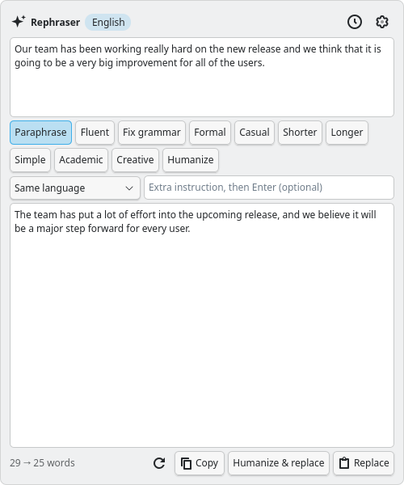
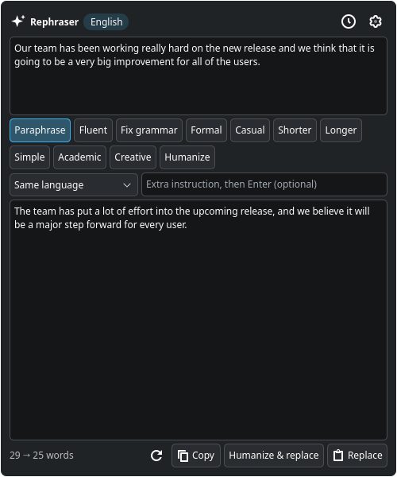
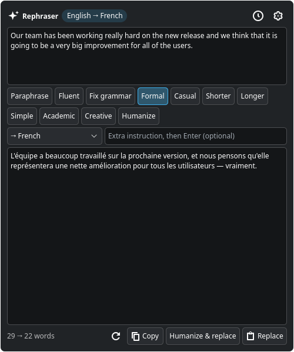
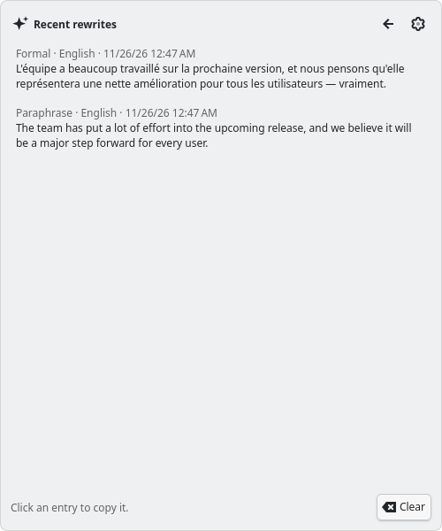

# Rephraser for Plasma

A KDE Plasma 6 widget that paraphrases, corrects, humanizes and translates the text you have selected
in any application, using your own Claude API key.

It is the desktop counterpart of the
[Rephraser Chrome extension](https://github.com/taghouti-org/claude-chrome-paraphraser).

| Rewrite with detected language | Dark theme |
| --- | --- |
|  |  |

| Translate while rewriting | Recent rewrites |
| --- | --- |
|  |  |

## How it works

1. Select text in any app: a browser, Kate, LibreOffice, a chat client, a terminal.
2. Open Rephraser: click its panel icon, or press the shortcut you gave it.
3. The widget reads the selection, sends it to Claude and streams the rewrite, with the detected
   language shown next to the title.
4. Choose what to do with it:
   - **Copy** puts the rewrite on the clipboard.
   - **Replace** closes the popup and pastes the rewrite over the selection in the app you came from.
   - **Humanize & replace** makes the text sound more natural first, then pastes it.

Switch mode to rewrite again, pick an output language to translate, or type an extra instruction and
press Enter. You can also type or paste straight into the top box.

**Modes:** Paraphrase, Fluent, Fix grammar, Formal, Casual, Shorter, Longer, Simple, Academic,
Creative, Humanize.

## Install

```sh
git clone https://github.com/taghouti-org/claude-plasma-paraphraser.git
cd claude-plasma-paraphraser
./install.sh
```

Then:

1. Right-click a panel (or the desktop), choose **Add or Manage Widgets**, and add **Rephraser**.
2. Right-click the widget, choose **Configure Rephraser**, paste a Claude API key (create one at
   [platform.claude.com → API keys](https://platform.claude.com/settings/keys)) and press **Test**.
3. In the same dialog, open **Keyboard Shortcuts** and set a shortcut, for example `Meta+Shift+R`.

A claude.ai chat subscription does not include API access; the key comes from a Claude Console account.

To remove it: `kpackagetool6 --type Plasma/Applet --remove org.taghouti.rephraser`.

## Requirements

- Plasma 6 (developed on 6.6, Wayland).
- For **Replace** on Wayland: `python3-dbus` and `python3-gi` (installed by default on Kubuntu) and
  `xdg-desktop-portal-kde`. The first time you use Replace, Plasma asks whether Rephraser may send
  keyboard input; allow it and the choice is remembered.
- For **Replace** on X11: `xdotool`.

## What it cannot do

Plasma on Wayland does not let one application draw inside another, so there is no floating icon next
to the selection or inside other apps' text fields, as the browser extension has. The widget is
opened from the panel or by shortcut instead.

Replace works by pasting, so the text must still be selected in the original app when the popup
closes. Terminals paste with `Ctrl+Shift+V`; change **Replace pastes with** in the settings if you
mostly work in one.

## Privacy

- Text is sent only to `api.anthropic.com`, and only when a rewrite runs. With **Rewrite the selected
  text right away** turned on (the default), opening the widget sends the current selection at once;
  turn it off in the settings to pick a mode first.
- The API key is stored in the widget's settings, in
  `~/.config/plasma-org.kde.plasma.desktop-appletsrc`, readable by your user account.
- History (the last 30 rewrites) is stored in the same file and can be turned off.

## Layout

| File | Role |
| --- | --- |
| `package/contents/ui/main.qml` | Panel icon, popup, selection capture, Replace |
| `package/contents/ui/RephraserView.qml` | The popup interface |
| `package/contents/ui/configGeneral.qml` | Settings page |
| `package/contents/code/core.js` | Modes, prompt, streaming Claude API client |
| `package/contents/tools/paste.py` | Sends the paste shortcut (portal on Wayland, xdotool on X11) |

No build step.
